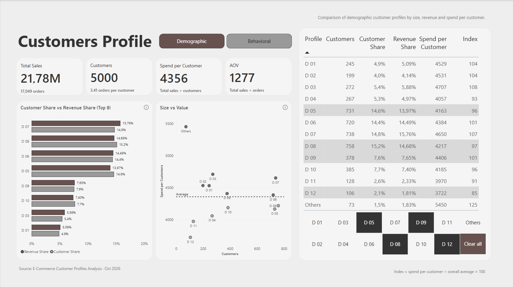
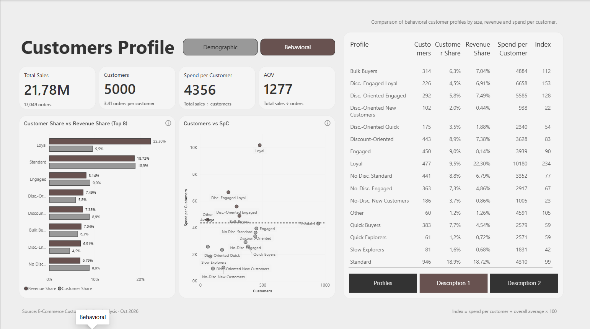

# E-Commerce Customer Profiles Dashboard

An interactive Power BI dashboard for exploring customer demographics and purchasing behavior in an e-commerce dataset.

## Project Overview

This project focuses on understanding customer characteristics and behavioral patterns through interactive data visualization. Built with Microsoft Power BI, the dashboard presents customer profile analysis across two main sections: **Demographic Analysis** and **Behavioral Analysis**.

The goal is to make customer data easier to explore and support data-driven business decisions.

## Dashboard Preview

### 1. Demographic Analysis

This page focuses on customer demographics and provides a visual overview of customer segments based on demographic characteristics.

### 2. Behavioral Analysis

This page explores customer behavioral profiles and provides insights into different purchasing and engagement patterns.

## Tools & Technologies

- **Microsoft Power BI** — Dashboard development and interactive data visualization
- **CSV** — Dataset storage and data input

## Repository Contents

| File | Description |
|---|---|
| `CP_DashBoard.pbix` | Power BI dashboard file |
| `dataset_cp.csv` | Dataset used in the project |
| `Demographic.png` | Demographic dashboard screenshot |
| `Behavioral.png` | Behavioral dashboard screenshot |

## How to Explore the Dashboard

1. Download `CP_DashBoard.pbix` from this repository.
2. Open the file in Microsoft Power BI Desktop.
3. Navigate between the Demographic and Behavioral report pages.
4. Interact with the available filters, charts, and navigation buttons to explore the data.

## Project Purpose

This project demonstrates practical skills in Power BI reporting, data visualization, customer segmentation, and exploratory customer analysis.

